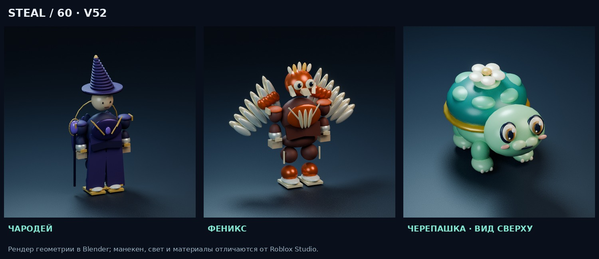

# Steal60 v52

**Готовая модель без ZIP:** [Steal60_v52.rbxmx](Steal60_v52.rbxmx).

На странице файла нажмите **Download raw file (↓)**. [Прямая ссылка на полный файл](https://github.com/RKuznietsov/backpacks-site/raw/refs/heads/roblox-atelier-v52/roblox/Steal60_v52.rbxmx) тоже доступна; если браузер показывает XML, сохраните его через Ctrl+S под именем `Steal60_v52.rbxmx`.

- Дрон: восстановление четвёртого пропеллера при неполной загрузке модели, отличимые вращающиеся кончики лопастей.
- Черепашка: крупная приподнятая мордочка, лучше видимая сверху.
- Питомцы: моргание и живые движения головы; общая анимация в игре и витрине.
- Разные типажи костюмов: чародей с посохом, открытый серафим, самурайская маска, птичий шлем и отдельный робот-пилот.
- Кнопка **ВЕРНУТЬ МОЙ АВАТАР** вверху вкладки **ГЕРОЙ**. Костюмы сохраняются в коллекции; снимается только надетый костюм. Одежда, лицо и личные аксессуары восстанавливаются.

Это рендер Blender, не скриншот Roblox Studio. Файлы содержат эту же процедурную геометрию; камера, свет и материалы в игре отличаются.

Проверены компиляция 58 скриптов, четыре ротора с поздней загрузкой, все костюмы и питомцы, снятие без списания валюты и откат при неудачном сохранении. Проверка в настоящем Roblox Engine здесь не выполнялась.

[Полная инструкция и ограничения](Steal60_v52_README.txt) · [Результаты проверок](Steal60_v52_validation.json)

Перед импортом сохраните копию place и свои Developer Product ID. Импортируйте модель в Workspace через Insert from File и запустите Play. Не запускайте два установщика одновременно.
