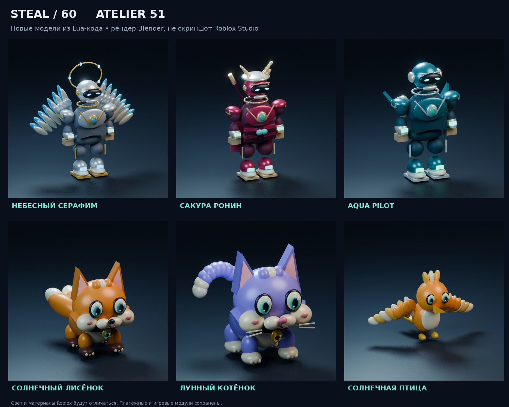
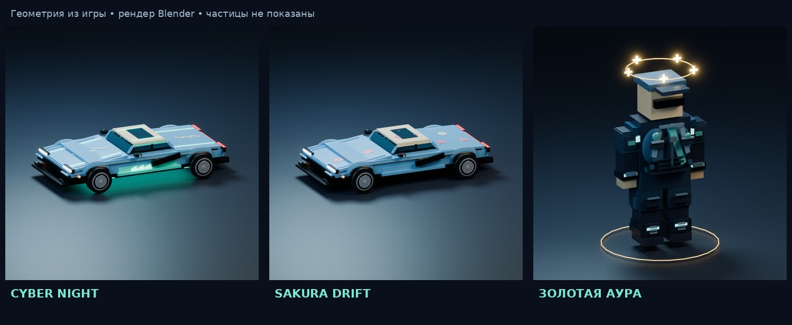

# Steal60 Atelier v51

[**Скачать готовый ZIP для Roblox Studio**](https://github.com/RKuznietsov/backpacks-site/raw/refs/heads/roblox-atelier-v51/roblox/Steal60_v51_Atelier.zip)

Распакуйте архив и импортируйте `Steal60_v51_Atelier.rbxmx` в копию проекта через **Insert from File**. Инструкция и ограничения находятся внутри архива. Это полный установочный пакет, а не PowerShell-скрипт.

Рендеры получены из размеров, координат, поворотов, форм и цветов деталей, создаваемых Lua-кодом нового пакета. Рендерер — Blender. Это не скриншоты Roblox Studio: материалы, свет, частицы и загрузка каталожных аксессуаров требуют отдельной проверки в игре.

Проверены 57 скриптов Luau, создание 55 костюмов, 10 питомцев, 150 машин, 135 комбинаций кузов/скин, четыре ауры, четыре облика продавцов, соединения и снятие оформления. Исходные 78 ID предметов и игровые/платёжные модули сохранены. Подробности — `Steal60_v51_validation.json` и инструкция в архиве.

Файлы помещены в отдельную ветку по разрешению владельца. Основная ветка сайта не изменялась.
